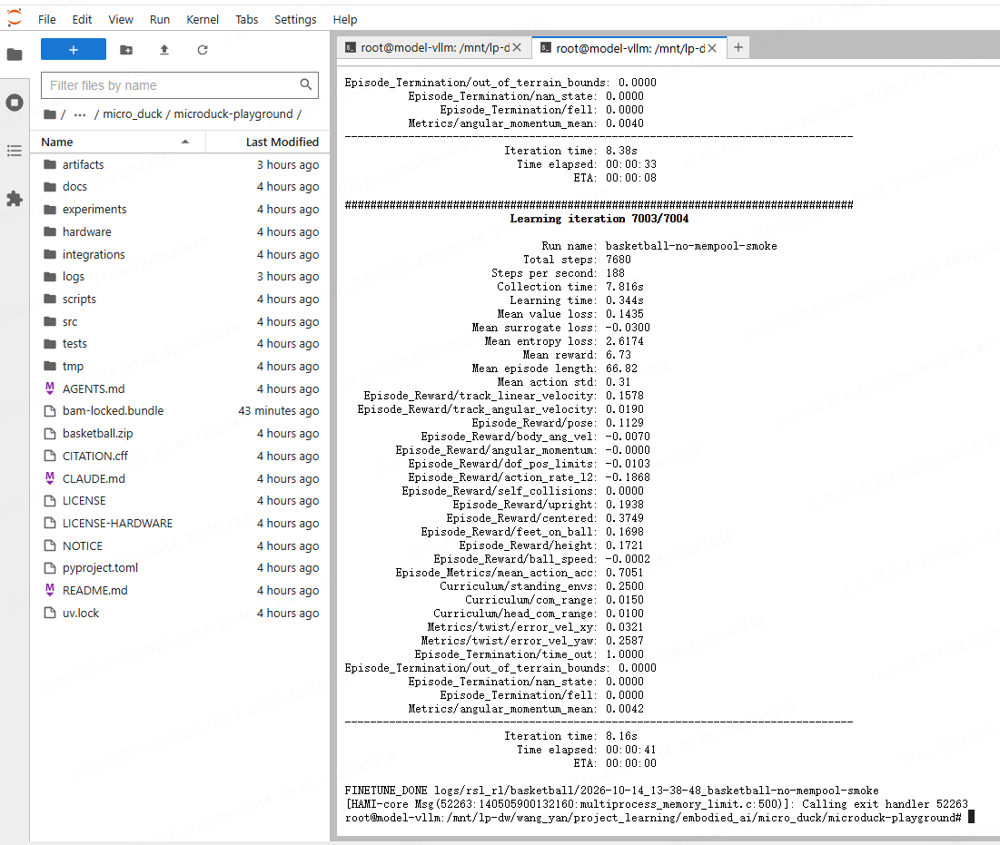

# Task 1：MicroDuck 篮球平衡强化学习

## 1. 任务与系统结构

MicroDuck 在自由滚动的篮球上保持直立，并跟踪平面速度和偏航角速度指令。控制频率为50 Hz，即每20 ms计算一次动作；控制频率与视频帧率不同。

```text
机器人状态 → 观测构造 → LSTM Actor → 关节动作 → 执行器与物理仿真 → 新状态
```

Actor 不直接读取球的位置和速度，因此称为 blind actor。训练时 Critic 可以额外读取球状态等特权信息，构成非对称 Actor–Critic；部署只需要 Actor。

### 部分可观测性：为什么有身体状态还不够

完整物理状态包括机器人、球的位置与速度，以及接触状态；Actor只能拿到其中一部分。设完整状态为s、观测为o，策略实际处理的是历史观测，而不是完整状态。

相似的当前姿态可能对应不同的球运动趋势，所需纠正动作也可能不同。这构成部分可观测控制问题。LSTM利用历史减少歧义，但不会凭空恢复所有缺失信息，也不等于经过验证的球状态估计器。

Actor–Critic的不对称信息设计，将训练时可获得的球真值用于价值估计，而不改变Actor部署接口。Critic提供的是训练信号，部署时无需继续调用它。

### 物理步与控制步

物理引擎通常以比策略更细的时间步求解接触和运动。一次策略动作可以在多个物理步中持续执行。若物理步长为Δt、每次动作保持k个物理步，则控制周期为kΔt。控制频率、物理步数、视频帧率和PPO迭代数不能混用。

策略给出关节目标后，执行器仍需要根据误差和电机模型产生作用力。策略、执行器控制与物理求解分别属于不同层次。

## 2. 61维观测与14维动作

Actor 观测形状为 `obs[1,61]`，索引采用Python左闭右开区间。

| 索引 | 内容 | 维度 |
|---|---|---:|
| `0:3` | 身体角速度 | 3 |
| `3:6` | 身体坐标系中的重力投影 | 3 |
| `6:20` | 关节位置观测 | 14 |
| `20:34` | 关节速度观测 | 14 |
| `34:48` | 上一步动作 | 14 |
| `48:51` | 前进、横移、偏航速度指令 | 3 |
| `51:55` | 头部命令槽，本任务置零 | 4 |
| `55:61` | 身体命令槽，本任务置零 | 6 |

观测必须按配置构造，包括相对默认姿态、尺度和归一化等约定，不能将原始传感器值任意拼接后直接输入模型。

输出 `actions[1,14]` 对应14个受控关节，经环境的缩放、默认姿态偏置与限幅等处理，转换为关节目标。网络输出不等同于原始角度或力矩。14个受控关节分布在左右腿与颈部/头部。索引必须与对应模型的关节排列一致。

### 数据从哪里来

真机身体角速度来自IMU陀螺仪；重力投影由姿态估计计算；关节角度由舵机反馈或编码器得到；关节速度可由反馈或角度差分得到。编码器零位、轴方向、传动比和单位需按硬件校准。上一动作和目标速度由程序提供。

仿真中，物理引擎根据力、惯性和接触计算状态变化，程序读取关节状态与虚拟传感器，再构造观测。仿真能读取球状态，但Actor不一定获准使用。

## 3. LSTM记忆和ONNX契约

```text
61维观测 → LSTM(256) → ELU MLP(512→256→128) → 14维动作
```

| 输入／输出 | 形状 | 含义 |
|---|---|---|
| `obs` | `[1,61]` | 当前观测 |
| `h_in`、`h_out` | `[1,1,256]` | 输入、输出隐藏状态 |
| `c_in`、`c_out` | `[1,1,256]` | 输入、输出记忆单元状态 |
| `actions` | `[1,14]` | 动作 |

LSTM状态维度依次表示：层数×方向数、batch大小、隐藏维度。因此h、c各有256个浮点数，前面的1不是记忆只有一个数字，也不是历史帧数。

标准LSTM通过门控更新状态：

```text
c_t = f_t ⊙ c_(t-1) + i_t ⊙ g_t
h_t = o_t ⊙ tanh(c_t)
```

f、i、o是遗忘门、输入门、输出门；g是候选记忆；⊙表示逐元素乘法。上一步状态已经压缩了更早的历史，所以“当前观测＋上一步记忆”仍能利用多步信息。它不完整保存所有历史，状态各分量也没有人为规定的物理含义。

运行时把 `h_out/c_out` 传给下一次调用。首次启动、策略切换或回合重置时清零；普通速度指令变化时保留。ONNX调用方负责维护这些状态。50 Hz不表示一次输入过去50帧。

### 循环网络训练不能破坏时序

推理时h/c逐步更新；训练时也必须让序列与初始状态对应。将所有时间步随意打乱、丢失回合边界，会使网络拿到错误历史。

循环PPO通常按序列组织小批量，用回合结束标记重置状态，并用mask处理补齐位置。反向传播通过有限长度序列更新LSTM参数，属于截断的时间反向传播。采样段长度不等于记忆固定只能保留这么多步。

例如每轮采样24个控制步，在50 Hz下是每个环境0.48秒的新增经验。一个episode可以跨多个采样段；采样段结束不等于回合结束。

## 4. PPO、奖励和优化器

PPO（Proximal Policy Optimization）是策略梯度强化学习算法，包含采样、优势估计、训练目标和参数更新流程；它不等同于损失函数。LSTM是网络结构，Adam是梯度优化器，lr是学习率。

```text
使用当前策略采样 → 计算回报与优势 → 多轮小批量优化Actor/Critic → 重新采样
```

训练时Actor输出动作分布并采样动作。Critic估计长期回报，优势衡量动作相对价值基线的好坏。LSTM与动作头通过策略损失联合训练，没有人为标注的“正确动作label”；Critic的目标由采样奖励和价值估计构造。

PPO-Clip的核心目标：

$$
L^{CLIP}=E[\min(\rho_t A_t,\operatorname{clip}(\rho_t,1-\epsilon,1+\epsilon)A_t)]
$$

其中概率密度比 $\rho_t=\pi_\theta(a_t|\text{观测与历史})/\pi_{old}(a_t|\text{观测与历史})$，A是估计优势。裁剪降低策略过度更新的激励，不保证所有概率比值严格处于区间内。实际训练还包括价值损失和熵项。

原论文：[Proximal Policy Optimization Algorithms](https://arxiv.org/abs/1707.06347)。

### 回报、价值与GAE

即时奖励r评价某一步，回报综合之后的奖励。折扣因子γ控制未来奖励的权重：

$$
G_t=\sum_{k=0}^{\infty}\gamma^k r_{t+k}
$$

常见的优势估计方法GAE先计算时序差分残差，再累积多步信息：

$$
\delta_t=r_t+\gamma V_{t+1}-V_t,\qquad
\hat A_t=\sum_{l=0}^{L-1}(\gamma\lambda)^l\delta_{t+l}
$$

这里省略了终止边界的mask；真实实现必须处理它。γ是回报折扣，λ控制多步估计的偏差与方差折中。价值基线降低策略梯度的方差，但不充当正确动作标签。参见[GAE原论文](https://arxiv.org/abs/1506.02438)。

### 一轮PPO的数据流

| 阶段 | 主要内容 |
|---|---|
| rollout | 观测、循环状态、采样动作、旧策略log probability、奖励、价值和终止标记 |
| 目标构造 | 根据奖励与价值计算回报目标、优势 |
| 策略优化 | 对采样动作重新计算概率，用新旧概率比构造裁剪目标 |
| 价值优化 | 让Critic逼近回报目标 |
| 新一轮交互 | 用更新后的策略收集新的数据 |

PPO属于on-policy方法。一批刚采集的数据可以做多次小批量更新，但不会像典型SAC训练那样长期从大规模历史回放池反复取旧数据。

### 真正终止与时间截断

摔倒是任务失败导致的终止；达到回合时限通常是人为截断。对于截断，价值目标可能需要从最后状态继续bootstrap；真正终止通常不应延续后续回报。若混淆两者，会改变Critic训练目标。具体处理以环境和训练器实现为准。

### 奖励设计与动作滤波

奖励同时考虑速度跟踪、直立、居中、脚球接触和根部高度，并惩罚动作突变、接近关节限位等行为。最终奖励是按任务配置加权的组合。

动作变化惩罚让策略自行权衡平滑与及时纠正。部署时额外加入训练中没有的低通滤波会改变动作响应并引入延迟，因此不能随意添加。若需要滤波，应将其纳入匹配的训练与验证流程。

## 5. 短训实验与日志解读

本次实验环境：Ubuntu、NVIDIA L40、Warp 1.12.0、CUDA Toolkit 12.9、Driver 12.8，并存在HAMI管理层。训练从公开篮球checkpoint继续，不是从随机初始化训练。

| 项目 | 结果 |
|---|---|
| 运行名 | `basketball-no-mempool-smoke` |
| 并行环境 | 64 |
| 新增PPO迭代 | 5 |
| 每轮每环境控制步 | 24 |
| 总采样 | 7680＝64×24×5 |
| 学习率 | 2e-5 |
| 训练循环耗时 | 约41秒，不含完整安装等前置耗时 |
| 末轮平均累计回报 | 6.73 |
| 末轮value/surrogate loss | 0.1435 / -0.0300 |
| 完成标记 | `FINETUNE_DONE` |
| 输出目录 | `logs/rsl_rl/basketball/2026-10-14_13-38-48_basketball-no-mempool-smoke` |



7003/7004是沿checkpoint继续计数的迭代标签，不代表这次训练7004轮。steps/s是跨并行环境的采样吞吐量，不是50 Hz控制频率。Mean action std是动作分布标准差，不是实测关节抖动。

Mean episode length单位是控制步；训练起始回合进度随机化与短统计窗口会影响它，不能直接当作独立稳定时间评测。分项奖励与Mean reward统计方式不同，不宜直接求和对照。

`fell=0`、`nan_state=0`表示对应日志窗口未记录这类终止。它们不证明独立评测成功率100%。生存率定义为指定评测时长内未摔倒的环境比例。它衡量固定测试条件下的持续稳定性，与累计奖励是不同指标。

$$
\text{生存率}=\frac{\text{评测时长内未摔倒的环境数}}{\text{参与评测的环境总数}}\times100\%
$$

## 6. 安装与训练故障定位

### GitHub依赖下载中断

BAM来自Git依赖：`better-actuator-models @ git+https://github.com/Rhoban/bam.git@62bd8ce12154340be97e06f7f41a0ca8f116d967`。

出现HTTP/2 CANCEL、GnuTLS异常终止、Empty reply等网络错误。切换HTTP/1.1未解决该服务器连接问题，因此准备指定提交的Git bundle，从本地仓库获取依赖。bundle需先上传服务器；当前目录缺少文件时无法clone。

```bash
git clone --bare ./bam-locked.bundle /tmp/microduck-bam-local.git
GIT_CONFIG_COUNT=1 \
GIT_CONFIG_KEY_0=url.file:///tmp/microduck-bam-local.git.insteadOf \
GIT_CONFIG_VALUE_0=https://github.com/Rhoban/bam.git \
uv sync --locked
```

这只临时替换BAM的获取地址，保持锁定提交；其他未缓存依赖仍需联网。Git依赖与PyPI依赖走不同下载链路，仅更换PyPI镜像不能解决GitHub源码下载中断。

### HAMI与CUDA Graph捕获

默认路径报 `cuMemPoolGetAttribute failed res=900`，继而出现901及100 KiB分配失败。900描述捕获期间不允许的操作；901是先前捕获错误的后续。不能据最终小额分配失败断言显存耗尽。

已验证的绕开方式：初始化前关闭Warp内存池，使mjlab 1.3.0不启用CUDA Graph，保留CUDA计算。短训随后成功。尚未分别隔离内存池、Graph与HAMI各组件，因此记录为该路径的兼容问题，不认定具体组件已被最终证明有缺陷。

可复用入口：[run_warp_compat.py](scripts/run_warp_compat.py)。它只影响当前进程，不修改上游代码或依赖版本。

## 7. 训练、推理与模型导出

训练阶段需要环境采样、奖励、Critic与优化器；推理阶段使用Actor根据观测和循环状态选择动作，不进行PPO参数更新。录制仿真视频属于推理过程，不等于重新训练。

Checkpoint保存用于恢复训练的状态，可能包含Actor、Critic、优化器和迭代信息；ONNX保存部署用的计算图。两者不是换一个文件扩展名的关系。导出时需要保留观测归一化和动作处理约定，循环策略还需要显式暴露h/c输入输出。

PyTorch/ONNX parity比较相同输入与循环状态下的动作和状态输出，判断导出是否保持数值一致性。模型接口与数值一致性通过，也不能替代机器人闭环表现评测。

视频输出目录由录像脚本管理，模型输出目录由导出参数管理，两者可能不同。视频用于检查身体姿态、接触和动作现象；生存率与速度误差用于量化表现。

## 8. 课程学习与续训的区别

篮球场景同时包含运动控制、摩擦接触和支撑物运动，直接在最难条件下从随机策略探索容易失败。课程学习通过逐步改变难度，让策略先获得基本行为，再适应更自由的球运动、更多扰动或更严格的平滑要求。

hold课程在训练早期限制球的运动，随后减弱辅助；它不代表最终自由球任务仍固定篮球。

本次续训入口直接将ball hold设为0，并移除对应课程，使用已经学会基础技能的checkpoint。因此“从零训练的课程”与“预训练策略的继续训练”是不同实验，不能把配置名称相似当作过程相同。

续训恢复的不只是Actor权重，还包括Critic和优化器状态。Adam状态含历史动量估计和参数组学习率；加载状态可能覆盖新指定的学习率。该项目的续训实现会在恢复后重新设置固定学习率2e-5，同时保留优化器统计量。这解释了专用续训脚本的必要性。

## 9. 仿真到真机：接口一致只是第一层

| 差异来源 | 对控制的影响 | 常见处理思路 |
|---|---|---|
| 传感器噪声、零偏与坐标系 | 同一姿态产生不同观测 | 校准、噪声建模、严格保持观测约定 |
| 舵机摩擦、延迟、限幅 | 目标动作与实际运动不同 | 执行器建模、延迟建模、参数随机化 |
| 球与脚底的接触和摩擦 | 滚动、滑动与支撑变化 | 接触模型检查、物理参数扰动 |
| 控制时序与状态重置 | 记忆对应了错误的时间过程 | 保持控制周期、正确传递h/c及reset |

Domain randomization在训练中改变物理或传感器参数，让策略适应一族环境。它减少对单个精确模型的依赖，但不能替代真实硬件校准，也不证明真实篮球任务已成功。

上一动作也属于观测：动作顺序、缩放和截断规则不一致，会影响下一步观测。部署因此必须同时对齐输入处理、网络计算、状态维护和动作后处理。

## 10. 如何判断策略质量

### 数值一致性与行为质量是两类问题

导出检查回答“同一模型换执行格式后，输出是否接近”；闭环评测回答“机器人是否能持续完成任务”。前者通过不能保证后者通过。

上游parity脚本构造40步随机观测，第20步重置PyTorch策略及ONNX的h/c，对比动作输出，允许rtol=1e-4、atol=2e-5的误差，并报告最大绝对动作误差。它通过状态递推测试循环接口，但没有直接断言两套h/c逐项相等，也没有运行真实物理闭环。

`export.py`生成ONNX；`verify_basketball_onnx_parity.py`比较已导出的ONNX与对应checkpoint。校验脚本本身不负责导出。`MICRODUCK_BB_BLIND=1`选择不读取球状态的Actor观测；`MICRODUCK_BB_HISTORY=1`选择单帧观测组织方式，历史仍通过LSTM传递，不能理解为关闭记忆。

### 同条件比较

生存率之外，还应观察速度跟踪、首次摔倒时间和动作变化。原模型与续训模型的比较应保持场景、命令分布、扰动、评测时长与种子一致，并覆盖多个种子。只比较奖励总分或只挑一段成功视频，无法判断改善是否可靠。

训练迭代更晚不一定更好。奖励项存在竞争，优化可能提高一个指标、损害另一个指标；checkpoint应根据固定评测协议选择，而不是自动选择最后保存的文件。

短训验证主要用于检查加载、采样、反向传播和保存链路。完整任务表现还取决于长时闭环与测试分布，而不是“训练正常结束”这一标记。

## 参考资料

本文按概念理解与本次实验重新组织，不转载上游教程正文或源码。模型结构和任务配置以项目实现为准。

- [Datawhale MicroDuck专题](https://github.com/datawhalechina/every-embodied/tree/main/16-专题组队学习/05-MicroDuck运动策略与任务开发专题)
- [MicroDuck Playground](https://github.com/Vottivott/microduck-playground)
- [篮球预训练模型](https://huggingface.co/HannesVonEssen/microduck-basketball)
- [PPO原论文](https://arxiv.org/abs/1707.06347)
- [GAE原论文](https://arxiv.org/abs/1506.02438)
- [循环ONNX校验实现](https://github.com/Vottivott/microduck-playground/blob/f010ef1cefcad49c05c20a4a78f840af83a643b9/scripts/verify_basketball_onnx_parity.py)
- [篮球续训配置实现](https://github.com/Vottivott/microduck-playground/blob/f010ef1cefcad49c05c20a4a78f840af83a643b9/src/mjlab_microduck/basketball_finetune.py)
