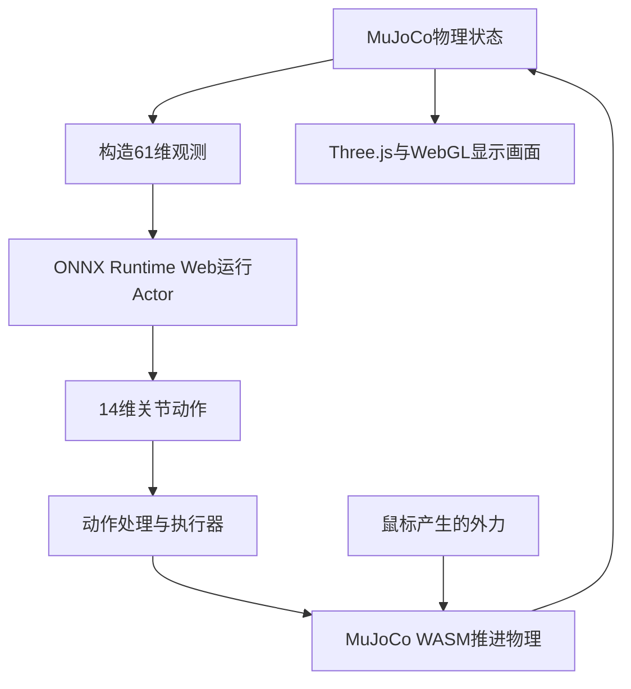
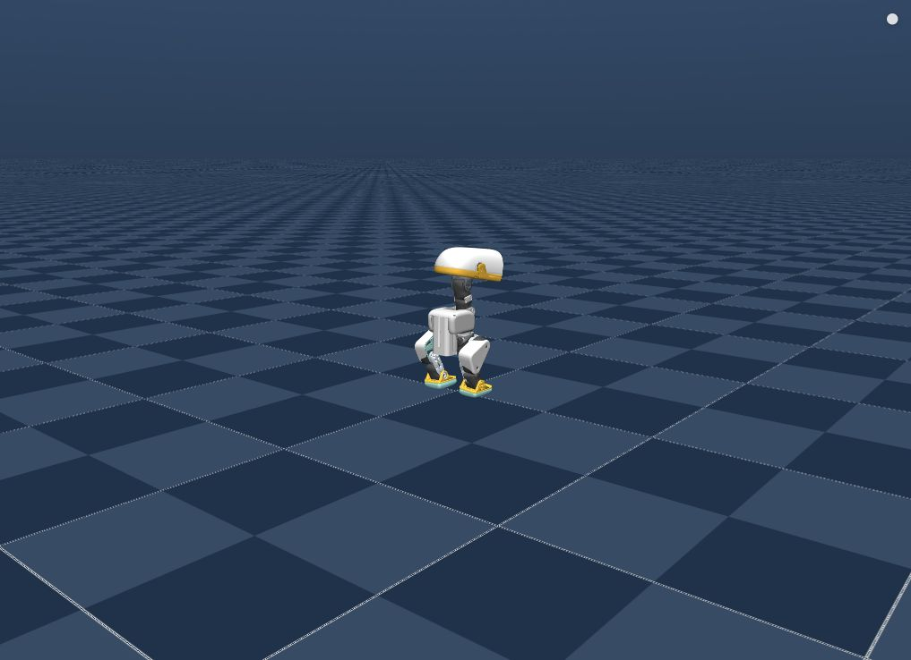

# 【Datawhale MicroDuck 组队学习】Task 2：浏览器物理仿真与外力扰动

## 1. 问题定义：已有策略如何进入浏览器闭环

Task 2关注已有策略的浏览器部署和物理交互，不进行PPO参数更新。机器人既受策略控制，也受重力、接触、摩擦和人为外力作用。网页中的运动来自实时计算，而不是预录视频。

与篮球任务相比，这次使用独立的mjswan Playground工程及其MicroDuck示例。输入输出同为61→14并不意味着模型可任意互换，场景、执行器、观测顺序和循环状态接口仍需匹配。

## 2. WASM、ONNX Runtime Web与WebGL

| 技术 | 定义 | 在本例中的职责 |
|---|---|---|
| WebAssembly（WASM） | 浏览器可加载并执行的编译代码格式 | 运行MuJoCo物理引擎 |
| ONNX Runtime Web | 浏览器侧ONNX模型推理运行时 | 用当前观测计算Actor动作 |
| WebGL | 浏览器图形接口 | 通过GPU绘制三维画面 |
| Three.js | 对WebGL等图形能力的封装 | 管理三维场景、摄像机、材质与模型显示 |
| JavaScript与页面逻辑 | 组织交互及运行流程 | 加载资源、构造观测、更新指令、调度运行 |

这些不是互斥的计算后端。ONNX Runtime Web自身也可以使用WASM执行模型计算，不能把所有WASM都理解成物理引擎。WebGL在这里用于图形渲染，不代表策略推理必然在GPU上执行。

WASM也不是Python代码直接在浏览器里运行：构建阶段将物理引擎、策略与运行所需的数据准备好，网页加载的是编译后的引擎、ONNX计算图及资源。

## 3. 构建阶段与运行阶段

### 构建：从Python工程到静态应用

Builder从锁定版本的上游仓库收集MJCF、网格、策略和控制定义，生成资源清单、场景文件与前端程序。这里的“构建”指打包和转换，不是训练神经网络。

| 文件或目录 | 用途 |
|---|---|
| `manifest.json` | 描述项目、场景、策略与资源关联 |
| `scene.mjz`等场景资源 | 保存浏览器可加载的物理场景 |
| ONNX文件 | 策略及观测、动作等相关计算图，以清单为准 |
| WASM与JavaScript | 浏览器执行引擎和应用逻辑 |
| `index.html`、CSS | 页面入口与控制界面 |

Python服务器负责通过HTTP提供资源；每一步仿真与策略计算并不需要向Python请求动作。因此完成打包后，浏览器可以承担交互闭环。

### 运行：状态、动作和物理反馈

画面帧率、物理求解步长和策略控制周期是不同概念。页面能流畅渲染，不等于已验证每20 ms稳定完成一次控制，也不能直接用视觉速度比较不同设备的策略性能。

## 4. 场景、策略与接口契约

本次构建清单包含4个场景和9个策略配置：

| 场景 | 策略 |
|---|---|
| Duck | Walk、Stand & Pose、Sit / Stand、Ground Pick、Roulade |
| Ball（right foot） | Kick |
| Ball（left foot） | Kick |
| Rollers | Skate、Crouch |

Scene决定物理世界中的物体、关节和执行器，Policy决定如何根据观测选择动作。某个策略只在相应场景下有效，不能把场景选择理解成换一张背景。

### 61维观测

观测由身体角速度3维、重力投影3维、关节相对位置14维、关节速度14维、上一动作14维和命令13维组成。命令块保留twist 3维、head 4维和body 6维，不使用的槽位填零。

这里的9个基础策略是 `obs[1,61] → actions[1,14]`，没有篮球LSTM策略的h/c接口。上一动作虽然提供一步历史信息，也不能将其等同于循环网络记忆。

### 14维动作

这个浏览器示例使用MJCF中的position执行器，采用默认站姿加关节动作偏移的形式：

$$
q_{target}=q_{STAND}+a
$$

这是本例的action scale=1配置，不是所有机器人策略的通用公式。position执行器根据目标与实际状态的差异作用于关节，策略没有直接改写机器人在世界中的坐标。

场景中的增益、力矩限制、阻尼和摩擦同样影响结果。即使观测和动作维度匹配，执行器模型变化也可能导致明显的行为差异。

## 5. 物理拖拽与力矩

鼠标拖拽是引擎级扰动：选择动态刚体及其作用点，依据指针移动计算作用力，将力及力矩提交给MuJoCo的外力接口，例如 `mjData.xfrc_applied`。

这一输入与Actor动作来自不同路径。Actor控制关节，拖拽则改变刚体受到的外界作用；后续观测反映受力后的状态，策略据此继续调整。

### 同一个力，为什么作用位置不同会有不同结果

作用点相对质心的位置为r、作用力为F时，对质心产生的力矩为：

$$
\tau=r\times F
$$

相近的力作用在躯干与头部，可能产生不同的转动趋势。它不仅取决于力的大小，还取决于力臂、方向、惯量和脚部接触。手动拖拽难以复现精确相同的力，因此适合定性比较，严谨实验应记录实际受力及持续时间。

### 松手后为什么还会动

释放鼠标会取消拖拽施加的外力，但不会清除物体已有的速度。惯性、重力、接触力和关节驱动仍然存在，机器人可能继续倾斜、迈步或倒地。

红色力箭头是当前扰动的可视化，不是网络预测出的运动轨迹，也不表示策略已经学会恢复技能。

## 6. 接触、摩擦与恢复能力

脚与地面的接触决定支撑与可传递的力。常见的库仑摩擦近似给出切向静摩擦力上限与法向力成比例；超过可承受的范围就可能滑动。实际MuJoCo接触还受具体摩擦参数与求解器设置影响。

身体倾斜、重心运动与支撑变化共同决定动态平衡。仅看某一帧的重心投影不足以完整解释迈步过程，还需要考虑速度、角动量和后续落脚。

应区分三类现象：

- **抗扰动**：受力后仍保持站立或行走。
- **摔倒恢复**：倒地后由适当策略主动起身。
- **场景重置**：程序直接恢复初始状态。

本例部分策略含倾斜触发的自动reset，Walk等策略的配置阈值为70°。因此看见机器人倒下后重新站在初始姿态，不应直接认定它完成了学习到的起身。需要判断是否发生reset或策略切换。

## 7. 浏览器推理与原始训练环境的差别

训练端可以使用BAM舵机模型、命令延迟、噪声和域随机化；本例浏览器端沿用XML中的position执行器。两者不完全等价。

| 层次 | 核心工作 |
|---|---|
| 强化学习训练 | 采样、奖励、价值估计、PPO参数更新 |
| 策略推理 | 固定参数，根据观测计算动作 |
| 物理仿真 | 根据作用力、约束和接触推进状态 |
| 渲染 | 将状态转换成屏幕图像 |

浏览器不运行Critic和PPO更新，也没有因为拖拽就自动学到新技能。策略受到未覆盖的扰动后失败，只能说明该模型在该条件下的表现，不能据此断定ONNX模型加载失败。

这一实践可以视作不同运行时和物理实现之间的一次部署检查，但不是实物机器人验证。场景接口、状态处理、动作处理和执行器假设需要一起对齐。

## 8. Mac本地运行记录

实验日期：2026-10-15。源码提交：`051ca48561db1849ce4f379efd60170c53c61fda`。

| 项目 | 记录 |
|---|---|
| 系统与芯片 | macOS，Apple Silicon arm64 |
| Python | 3.12.13 |
| mjswan | 0.11.9 |
| mjlab | 1.6.0 |
| MuJoCo | 3.11.0 |
| 依赖同步 | `uv sync --locked` |
| 构建目录 | `dist/microduck`，约62 MB |
| 服务地址 | `http://127.0.0.1:8092/` |
| 浏览器场景／策略 | Duck／Walk |
| 指令检查 | Forward设为0.3 m/s，界面值更新，画面观察到迈步姿态 |

画面与控制面板说明场景和交互入口已运行；0.3 m/s是目标指令，不是测得的实际速度。本次记录的是本机构建与运行，没有进行定量速度跟踪评测或抗扰动成功率统计。鼠标外力机制来自课程与实现说明，不将其写成本次已经完成的对照实验。

### Node.js路径问题

构建工具已下载独立Node.js环境，但执行npm时出现 `env: node: No such file or directory`。npm入口通过PATH查找node，调用npm的绝对路径并不会自动让它找到旁边的node可执行文件。

处理方式是在启动前将项目独立Node环境的bin目录加入当前进程PATH，随后npm依赖安装与前端构建成功。该处理没有更换Python依赖版本，也没有修改上游源码。

### 环境安装不等于需要CUDA训练

这个任务用Python准备资源、用浏览器执行闭环，Mac可以完成主线。安装依赖时看到torch或Warp，不代表网页运行必须使用NVIDIA CUDA，更不代表正在训练模型。它与Task 1服务器端的HAMI／CUDA Graph问题属于不同路径。

## 9. HTTP、WASM与资源加载

静态应用仍应通过HTTP服务打开。直接双击HTML形成file协议访问，可能触发模块、WASM或Worker的资源限制。

服务端要返回正确MIME类型，例如JavaScript的脚本类型与WASM的 `application/wasm`。多线程WASM常见的SharedArrayBuffer使用还要求页面满足跨源隔离等条件；本次服务返回了COOP与COEP响应头。

排查应沿资源链分层：

| 现象 | 检查方向 |
|---|---|
| 一直Loading | 场景、WASM与ONNX请求是否成功，是否下载完整 |
| 页面存在但无三维画面 | WebGL初始化、资源与浏览器控制台 |
| 有机器人但无动作 | 当前策略、ONNX执行与命令值，是否暂停 |
| 拖拽无效 | 是否命中动态刚体、是否启用相应交互模式 |
| 倒地后突然回初始姿态 | 自动reset条件与策略配置 |

资源返回200只说明下载请求成功；模型文件可解析只说明格式正确；还需要把观测、推理、动作和物理连起来，才能观察策略行为。

## 10. 代码阅读线索

以下为已阅读源码的定位说明，不在本笔记仓库复制上游工程。

| 位置 | 关注点 |
|---|---|
| `src/mjswan_playground/_cli.py` | list、build、run如何组织 |
| `src/mjswan_playground/_deps.py` | 锁定提交、缓存目录、上游资源获取 |
| `src/mjswan_playground/microduck/main.py` | 场景、策略、命令范围和Builder配置 |
| `src/mjswan_playground/microduck/terms.py` | 观测与命令如何映射 |
| 构建产物 `manifest.json` | 运行时如何关联场景、策略与计算图 |

Task 1的重点在策略如何学习；Task 2将注意力放到策略如何作为控制系统的一部分运行。网络输出、执行器响应、外部扰动和物理反馈共同决定最终行为。

## 参考资料

- [Datawhale Task 2课程](https://github.com/datawhalechina/every-embodied/tree/main/16-专题组队学习/05-MicroDuck运动策略与任务开发专题/01-任务资料/02-mjswan-MicroDuck浏览器物理扰动)
- [mjswan Playground](https://github.com/ttktjmt/mjswan_playground)
- [本次版本MicroDuck示例说明](https://github.com/ttktjmt/mjswan_playground/blob/051ca48561db1849ce4f379efd60170c53c61fda/src/mjswan_playground/microduck/README.md)
- [mjswan](https://github.com/ttktjmt/mjswan)
- [MuJoCo计算原理](https://mujoco.readthedocs.io/en/stable/computation/)
- [ONNX Runtime Web](https://onnxruntime.ai/docs/tutorials/web/)
- [WebAssembly](https://developer.mozilla.org/en-US/docs/WebAssembly)
- [WebGL](https://developer.mozilla.org/en-US/docs/Web/API/WebGL_API)
